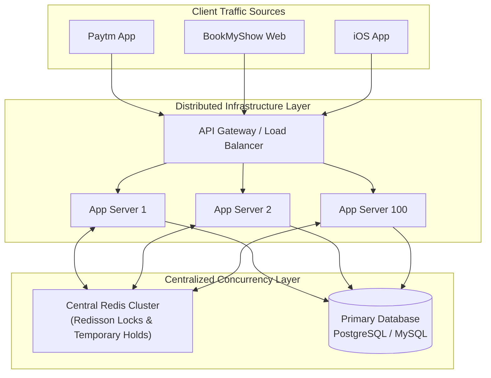
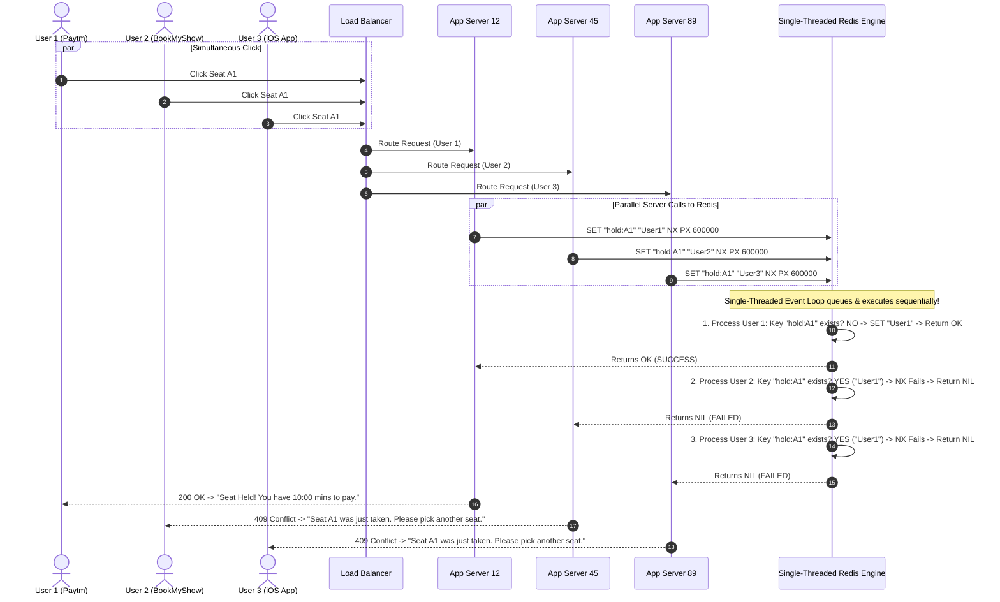

# 02. High Concurrency & Flash Sale Reservation Architecture

## 📖 Table of Contents
1. [The Flash Sale & Overbooking Problem](#1-the-flash-sale--overbooking-problem)
2. [Database Pessimistic Locking (SELECT ... FOR UPDATE)](#2-database-pessimistic-locking-select--for-update)
3. [Database Optimistic Locking (@Version & CAS)](#3-database-optimistic-locking-version--cas)
4. [Distributed Redis Lua Scripting (Atomic Check-and-Set)](#4-distributed-redis-lua-scripting-atomic-check-and-set)
5. [Comparative Analysis & Throughput Benchmarks](#5-comparative-analysis--throughput-benchmarks)

---

## 1. The Flash Sale & Overbooking Problem

In high-concurrency event booking or flash sales (e.g. reserving 100 limited tickets or seats out of 50,000 incoming requests/second):
- **Race Condition**: Multiple threads read `remaining_inventory = 1` simultaneously.
- Both threads execute `remaining_inventory - 1`, writing `0` back to the database.
- Result: **Overbooking (Double Booking)**!

---

## 2. Database Pessimistic Locking (`SELECT ... FOR UPDATE`)

Pessimistic locking assumes conflicts are high and locks the row exclusively during the transaction:

```sql
BEGIN TRANSACTION;
SELECT * FROM seats WHERE id = 'A1' FOR UPDATE;
-- Exclusive row lock acquired! All other threads block.
UPDATE seats SET status = 'RESERVED' WHERE id = 'A1';
COMMIT;
```

### 🔴 Trade-offs:
- **Pros**: 100% data consistency guaranteed by SQL engine.
- **Cons**: Threads wait in queue, starving DB connection pools (HikariCP). High latency, potential deadlocks under multi-row locks.

---

## 3. Database Optimistic Locking (`@Version` & CAS)

Optimistic locking avoids database locks. It appends a version check on `UPDATE`:

```java
@Entity
public class SeatEntity {
    @Id
    private String id;

    @Version
    private Long version; // Auto-incremented on every update by JPA
}
```

SQL Generated by Hibernate:
```sql
UPDATE seats SET status = 'RESERVED', version = 2 
WHERE id = 'A1' AND version = 1;
```

If another thread updated `version` first, 0 rows are updated and Spring throws `OptimisticLockingFailureException`.

---

## 4. Distributed Redis Lua Scripting (Atomic Check-and-Set)

Redis executes commands single-threaded. A Lua script executes **atomically** in microseconds:

```lua
local current = tonumber(redis.call('GET', KEYS[1]) or '0')
local limit = tonumber(ARGV[1])

if current < limit then
    redis.call('INCR', KEYS[1])
    return 1 -- Reservation Successful
else
    return 0 -- Rejected (Sold Out)
end
```

### 🟢 Advantages:
- Microsecond latency ($\le 1 \text{ ms}$).
- 100,000+ ops/sec throughput without database locks.

---

## 5. Redisson Distributed Locks & The Watchdog Mechanism

When scaling across 100 application servers behind a Load Balancer, local JVM locks (`ReentrantLock`) fail because memory is isolated per JVM. **Redisson** provides a distributed mutex lock across all nodes using Redis:

```java
RLock lock = redissonClient.getLock("seat-lock:SEAT-A1");
try {
    if (lock.tryLock(5, 10, TimeUnit.SECONDS)) {
        // Critical Section across 100 servers!
        reserveSeat("SEAT-A1");
    }
} finally {
    lock.unlock();
}
```

### 🐶 The Watchdog Mechanism (Auto Lock Renewal)
Spawns a background timer thread that periodically extends the lock TTL (`PEXPIRE`) every **10 seconds** as long as the owner thread is active, preventing premature lock expiration.

---

## 6. Distributed Multi-Website Booking Architecture (BookMyShow / Paytm)



---

## 7. Microsecond Race Condition Resolution (`SET key value NX PX`)

When User 1 (Paytm), User 2 (BookMyShow), and User 3 (iOS App) click Seat A1 at the **exact same millisecond**:



### Key Execution Flags:
- **`NX`**: Only set key if it does NOT already exist.
- **`PX 600000`**: Automatically expires temporary seat hold in 10 minutes if payment is abandoned.


