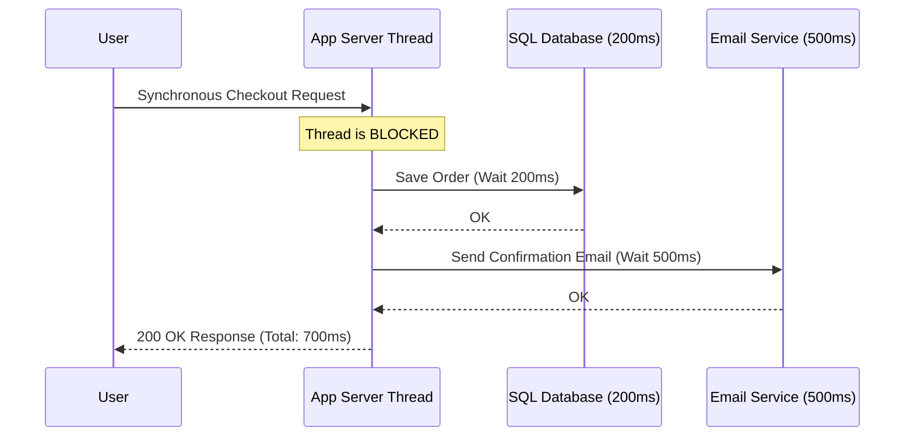
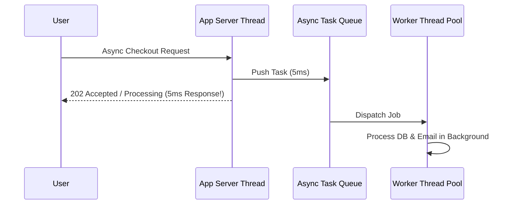

# 03. Multi-Threading & Synchronous vs Asynchronous Execution Architecture

## 📖 Table of Contents
1. [Synchronous (Blocking) vs Asynchronous (Non-Blocking) Architecture](#1-synchronous-blocking-vs-asynchronous-non-blocking-architecture)
2. [Java ThreadPoolExecutor Tuning & Bounded Queues](#2-java-threadpoolexecutor-tuning--bounded-queues)
3. [The 4 Thread Rejection Policies & Backpressure](#3-the-4-thread-rejection-policies--backpressure)
4. [Java 21 Virtual Threads (Project Loom): Platform Threads vs Virtual Threads](#4-java-21-virtual-threads-project-loom-platform-threads-vs-virtual-threads)
5. [CPU-Bound vs I/O-Bound Workload Dynamics & Thread Pinning](#5-cpu-bound-vs-io-bound-workload-dynamics--thread-pinning)

---

## 1. Synchronous (Blocking) vs Asynchronous (Non-Blocking) Architecture



### Asynchronous Event Pipeline:


---

## 2. Java ThreadPoolExecutor Tuning & Bounded Queues

```java
ThreadPoolExecutor executor = new ThreadPoolExecutor(
    10,                            // Core Pool Size (Always active)
    50,                            // Maximum Pool Size (Peak load capacity)
    60L, TimeUnit.SECONDS,         // Keep-Alive Time for idle max threads
    new ArrayBlockingQueue<>(500),  // Bounded Queue (Prevents OOM)
    new ThreadPoolExecutor.CallerRunsPolicy() // Rejection Policy
);
```

---

## 3. The 4 Thread Rejection Policies & Backpressure

When the 500-item queue fills up and all 50 max threads are busy:
1. **`AbortPolicy`** (Default): Throws `RejectedExecutionException` (Fail Fast).
2. **`CallerRunsPolicy`**: The calling HTTP thread executes the task itself, creating natural **Backpressure**.
3. **`DiscardOldestPolicy`**: Drops the oldest task in queue.
4. **`DiscardPolicy`**: Drops the newly submitted task silently.

---

## 4. Java 21 Virtual Threads (Project Loom)

| Feature | OS / Platform Threads | Java 21 Virtual Threads |
| :--- | :--- | :--- |
| **OS Mapping** | 1:1 with Kernel Thread | $M:N$ (Millions of virtual threads on 8 OS threads) |
| **Memory Footprint** | ~1 MB per thread | ~1 KB per thread |
| **Max Capacity** | ~5,000 threads per JVM | **1,000,000+** virtual threads |

---

## 5. CPU-Bound vs I/O-Bound Workload Dynamics & Thread Pinning

- **I/O-Bound Workloads**: Virtual threads yield 100x throughput because the JVM **unmounts** the virtual thread from the OS carrier thread during network waits.
- **CPU-Bound Workloads**: Virtual threads provide **zero performance benefit** because continuous CPU execution leaves no room for context switching.
- **Thread Pinning**: Virtual threads executing inside `synchronized` blocks or native JNI calls become **pinned** to OS threads and cannot unmount. *Solution*: Use `ReentrantLock`.
