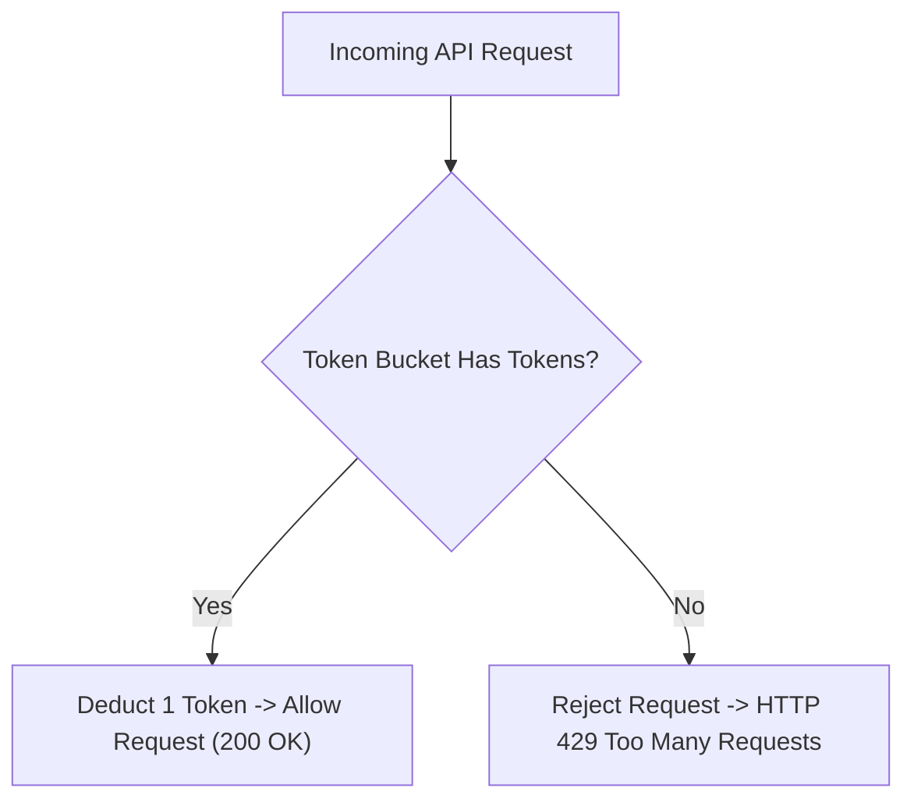
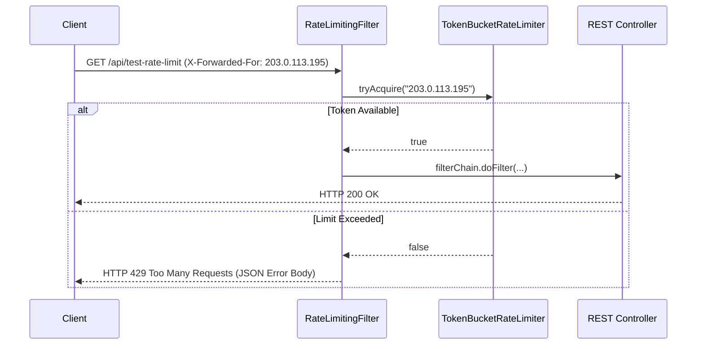

# 04. API Rate Limiting & Throttling Architecture

## 📖 Table of Contents
1. [Why Rate Limiting is Critical in Microservices](#1-why-rate-limiting-is-critical-in-microservices)
2. [The 4 Rate Limiting Algorithms (Token Bucket, Leaky Bucket, Fixed Window, Sliding Window)](#2-the-4-rate-limiting-algorithms)
3. [Lazy Token Refill Math Architecture](#3-lazy-token-refill-math-architecture)
4. [Spring Boot Web Filter Integration (`OncePerRequestFilter`)](#4-spring-boot-web-filter-integration)
5. [Distributed Rate Limiting with Redis Lua Scripts](#5-distributed-rate-limiting-with-redis-lua-scripts)

---

## 1. Why Rate Limiting is Critical in Microservices

Rate limiters protect API gateways and backend services from:
- **DDoS Attacks & Bot Scrapers**: Blocking malicious traffic before reaching databases.
- **Resource Starvation**: Preventing a single client from consuming 100% of thread pool resources.
- **Monetization Tiers**: Enforcing Free vs Premium API quotas.

---

## 2. The 4 Rate Limiting Algorithms



| Algorithm | Mechanism | Advantages | Disadvantages |
| :--- | :--- | :--- | :--- |
| **Token Bucket** | Tokens refill at constant rate up to max capacity. | Allows short bursts of traffic while enforcing average rate. | Memory needed for per-client bucket map. |
| **Leaky Bucket** | Requests queue in a bucket and process at a fixed output rate. | Smooths out traffic spikes completely. | Bursty traffic experiences latency in queue. |
| **Fixed Window** | Counts requests in static time windows (e.g. 1 min). | Extremely simple to implement in memory. | **Border Burst Problem**: 2x limit allowed across window boundaries. |
| **Sliding Window** | Computes requests using weighted rolling time window. | 100% accurate, solves border bursts. | Slightly higher memory footprint. |

---

## 3. Lazy Token Refill Math Architecture

Rather than running background timer threads for every client IP, we compute refilled tokens **on-demand** during `tryAcquire(clientIp)`:

```java
long now = System.nanoTime();
long nanosPassed = now - lastRefillTime;
double tokensToAdd = nanosPassed * refillRatePerNano;
tokens = Math.min(capacity, tokens + tokensToAdd);
lastRefillTime = now;

if (tokens >= 1.0) {
    tokens -= 1.0;
    return true; // Allowed
}
return false; // Rejected (429)
```

---

## 4. Spring Boot Web Filter Integration (`OncePerRequestFilter`)


