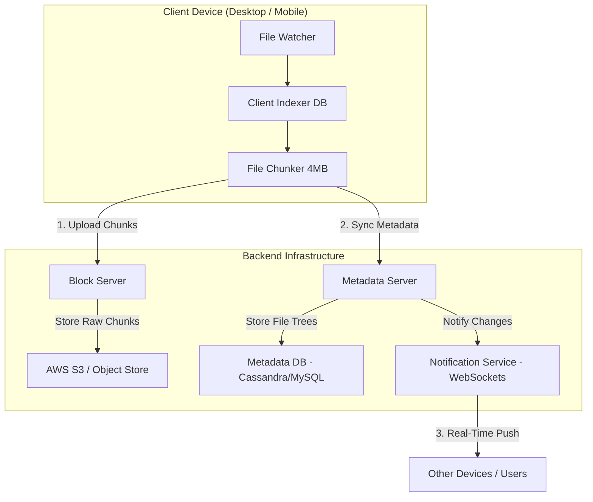
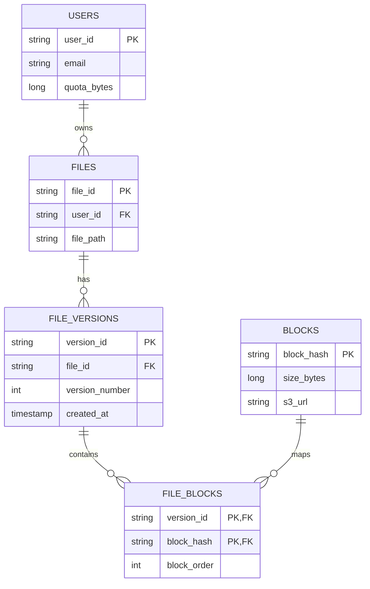

# 05. DropBox & Cloud File Storage System Design

## 📖 Table of Contents
1. [System Requirements & Scale Estimates](#1-system-requirements--scale-estimates)
2. [High-Level System Architecture](#2-high-level-system-architecture)
3. [Core Technical Pillars](#3-core-technical-pillars)
   - [File Chunking & SHA-256 Hashing](#file-chunking--sha-256-hashing)
   - [Chunk-Level Deduplication](#chunk-level-deduplication)
   - [Delta Sync Algorithm](#delta-sync-algorithm)
4. [Database Schema & Metadata Storage](#4-database-schema--metadata-storage)
5. [Client-Side Sync Engine Architecture](#5-client-side-sync-engine-architecture)

---

## 1. System Requirements & Scale Estimates

- **Capacity**: 500 Million Users, 100 Million Daily Active Users (DAU).
- **Storage**: Average 200 files per user $\rightarrow$ 100 Billion files total.
- **Traffic**: 10 Billion sync requests per day.
- **Key Constraints**: High Availability, ACID File Metadata consistency, microsecond Delta Sync, Cross-device sync.

---

## 2. High-Level System Architecture

---

## 3. Core Technical Pillars

### File Chunking & SHA-256 Hashing
- Large files (e.g. 1 GB video) are split into fixed **4MB chunks**.
- Each chunk is cryptographically hashed using **SHA-256** to generate a unique 64-character hash signature.

### Chunk-Level Deduplication
- Before uploading a 4MB chunk, the client queries the Metadata DB with the SHA-256 hash.
- **If the hash already exists in S3 (from any user globally)**, the upload is skipped instantly! Only the file metadata pointer is created.
- **Result**: Saves up to 60% of total storage and bandwidth.

### Delta Sync Algorithm
- When a user modifies a 500MB document (e.g., editing 2 lines), only the modified 4MB chunk is re-hashed and uploaded.
- The remaining 124 unchanged chunks are reused automatically.

---

## 4. Database Schema & Metadata Storage

---

## 5. Client-Side Sync Engine Architecture

The Desktop / Mobile client contains 4 decoupled components:
1. **File Watcher**: Monitors local file system changes (e.g. `inotify` on Linux, `FSEvents` on macOS).
2. **Chunker**: Splits modified files into 4MB chunks and computes SHA-256 hashes.
3. **Indexer**: Manages local SQLite database containing file state, modified timestamps, and chunk hashes.
4. **Sync Manager**: Communicates with Backend Block Servers and Notification Service via HTTP/2 & WebSockets.
