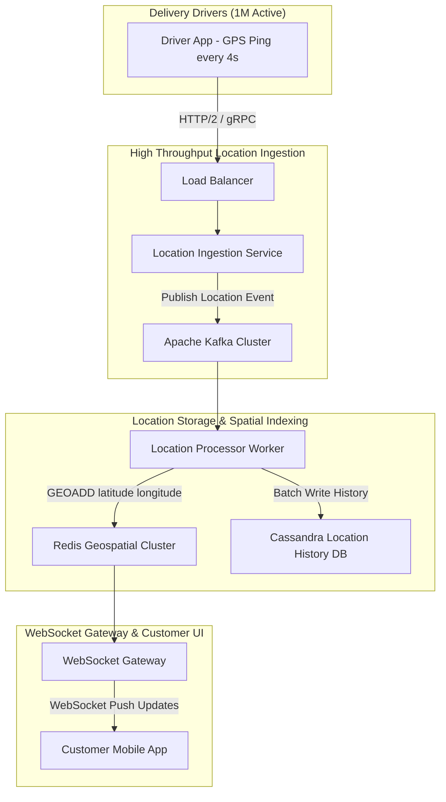
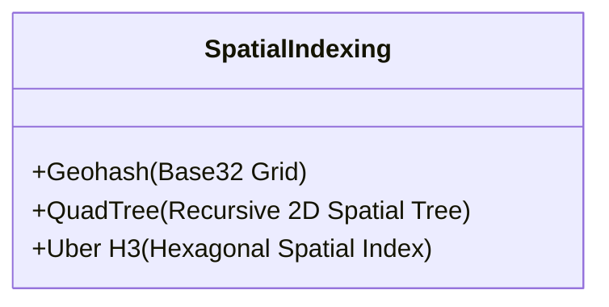

# 06. Real-Time Delivery & Driver Location Tracking System Design

## 📖 Table of Contents
1. [System Requirements & Scale Estimates](#1-system-requirements--scale-estimates)
2. [High-Level Architecture (Uber / Swiggy / DoorDash Style)](#2-high-level-architecture-uber--swiggy--doordash-style)
3. [Spatial Indexing Algorithms (Geohash vs QuadTree vs Uber H3)](#3-spatial-indexing-algorithms-geohash-vs-quadtree-vs-uber-h3)
4. [High-Throughput Ingestion Pipeline (Kafka + Redis Geospatial)](#4-high-throughput-ingestion-pipeline-kafka--redis-geospatial)
5. [Client Smoothing: Dead Reckoning & Map Matching](#5-client-smoothing-dead-reckoning--map-matching)

---

## 1. System Requirements & Scale Estimates

- **Scale**: 1 Million Active Drivers / Delivery Partners sending GPS coordinates every 4 seconds.
- **Ingestion Throughput**: $1,000,000 / 4 = 250,000 \text{ writes/sec}$.
- **Active Customers Tracking Deliveries**: 10 Million Concurrent Users receiving real-time vehicle movement updates.
- **Latency Requirement**: $< 1 \text{ second}$ end-to-end latency from driver phone to customer UI.

---

## 2. High-Level Architecture (Uber / Swiggy / DoorDash Style)



---

## 3. Spatial Indexing Algorithms (Geohash vs QuadTree vs Uber H3)

To query "Find nearest delivery drivers within 2 km":



| Indexing Method | Structure | Pros | Cons |
| :--- | :--- | :--- | :--- |
| **Geohash** | Base32 string representing 2D grid cell (e.g. `tdr4b6`). | Simple string prefix matching (`WHERE geohash LIKE 'tdr4%'`). | **Edge Distortion**: Adjacent points across cell boundaries have different prefixes. |
| **QuadTree** | 2D tree where each node splits into 4 sub-quadrants. | Dynamic node splitting based on driver density (dense in cities, sparse in rural). | In-memory structure; complex to rebalance across distributed servers. |
| **Uber H3** | **Hexagonal Grid Partitioning** (16 resolution levels). | **Equal Neighbor Distances**: All 6 neighboring hexes have identical center point distance! | Requires H3 C/Java library integration. |

---

## 4. High-Throughput Ingestion Pipeline (Kafka + Redis Geospatial)

### 1. Ingestion:
- Driver sends `{ driverId: "D-9912", orderId: "ORD-500", lat: 12.9716, lng: 77.5946, speed: 25.4, timestamp: 1700000000 }`.

### 2. Redis Geospatial Storage:
- Drivers stored using Redis `GEOADD`:
  ```redis
  GEOADD active_drivers 77.5946 12.9716 "D-9912"
  ```
- Querying active drivers within 3 km of a restaurant:
  ```redis
  GEORADIUS active_drivers 77.5946 12.9716 3 km WITHDIST
  ```

---

## 5. Client Smoothing: Dead Reckoning & Map Matching

GPS signals update only once every 4 seconds and suffer from noise/jitter.

To show smooth vehicle motion on the customer's map UI:
1. **Snap-to-Road (Map Matching)**: Snapping raw GPS lat/lng points to the nearest road vector on OpenStreetMap / Google Maps.
2. **Dead Reckoning Interpolation**: Customer app uses vehicle velocity & heading angle to animate the delivery bike smoothly along the road between 4-second GPS updates!
