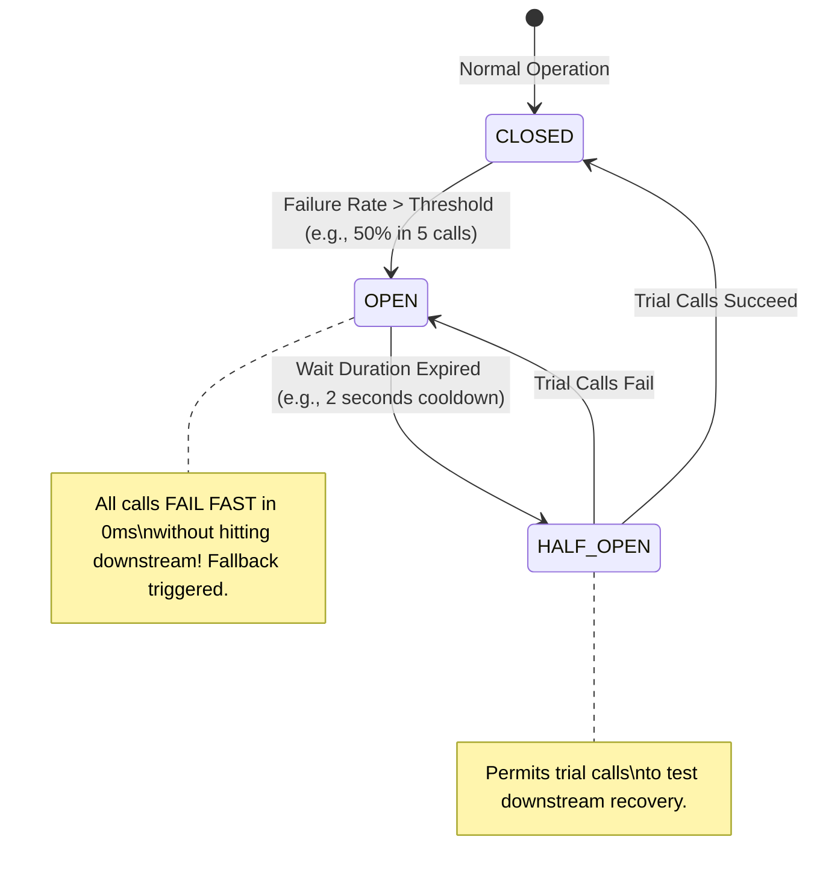

# 07. Resiliency & Fault Tolerance (Resilience4j Circuit Breakers)

## 📖 Table of Contents
1. [Why Circuit Breakers Matter in Microservices](#1-why-circuit-breakers-matter-in-microservices)
2. [The 3 Circuit Breaker States (CLOSED, OPEN, HALF-OPEN)](#2-the-3-circuit-breaker-states-closed-open-half-open)
3. [Resilience4j Spring Boot 3 Integration](#3-resilience4j-spring-boot-3-integration)
4. [Programmatic State Verification & Unit Testing](#4-programmatic-state-verification--unit-testing)

---

## 1. Why Circuit Breakers Matter in Microservices

In a distributed microservices environment, when a downstream payment gateway or microservice becomes unresponsive or times out:
- Without a Circuit Breaker, upstream caller threads remain blocked waiting for socket timeouts.
- **Cascading Failure**: HikariCP connection pools and HTTP Tomcat threads are quickly exhausted, bringing down the entire platform.

---

## 2. The 3 Circuit Breaker States (CLOSED, OPEN, HALF-OPEN)



1. **`CLOSED` (Normal)**: Requests pass through normally. Circuit Breaker calculates failure rates over a sliding window (e.g. 5 calls).
2. **`OPEN` (Failing Fast)**: Failure rate exceeds threshold ($\ge 50\%$). All subsequent calls fail fast instantly in `0ms` by executing a **Fallback Method** (`paymentFallback`).
3. **`HALF_OPEN` (Probe Recovery)**: After a cooldown period (e.g. 2 seconds), the circuit permits trial calls. If trial calls succeed, the circuit resets to `CLOSED`.

---

## 3. Resilience4j Spring Boot 3 Integration

### Service Class (`PaymentGatewayClient.java`):

```java
@Service
public class PaymentGatewayClient {

    @CircuitBreaker(name = "paymentService", fallbackMethod = "paymentFallback")
    public String processPayment(String bookingId, double amount) {
        if (simulateFailure) {
            throw new RuntimeException("Payment Gateway Timeout (504)");
        }
        return "SUCCESS:" + bookingId;
    }

    public String paymentFallback(String bookingId, double amount, Throwable ex) {
        return "FALLBACK_TICKET_HELD:" + bookingId;
    }
}
```

---

## 4. Programmatic State Verification & Unit Testing

### Test Suite Output (`PaymentCircuitBreakerTest.java`):

```
[main] External Payment Gateway Failure!
[main] Fallback Executed: Payment Gateway Timeout (504)
[main] External Payment Gateway Failure!
[main] Fallback Executed: Payment Gateway Timeout (504)
[main] External Payment Gateway Failure!
[main] Fallback Executed: Payment Gateway Timeout (504)
[main] Fallback Executed: CircuitBreaker 'paymentService' is OPEN and does not permit further calls
[INFO] Tests run: 3, Failures: 0, Errors: 0, Skipped: 0
[INFO] BUILD SUCCESS
```
