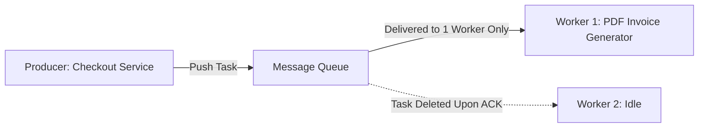
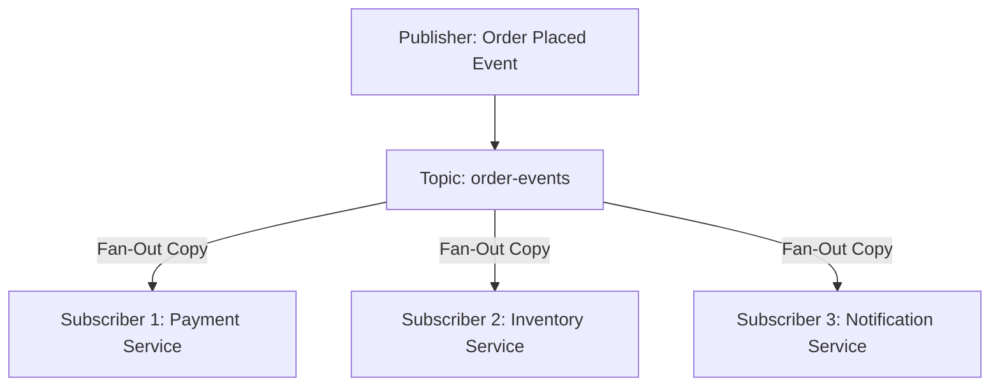
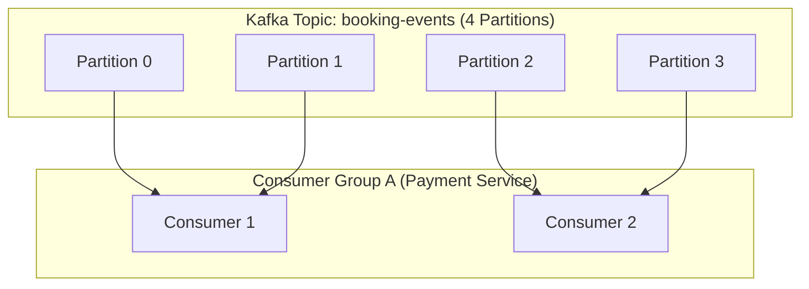

# 08. Event-Driven Architecture, Message Queues & Pub-Sub

## 📖 Table of Contents
1. [Message Queue vs. Pub-Sub Architecture](#1-message-queue-vs-pub-sub-architecture)
2. [Point-to-Point Message Queue Pattern](#2-point-to-point-message-queue-pattern)
3. [Publish-Subscribe (Pub-Sub) Fan-Out Pattern](#3-publish-subscribe-pub-sub-fan-out-pattern)
4. [Kafka Consumer Groups & Partition Scaling](#4-kafka-consumer-groups--partition-scaling)
5. [Comparative Technology Selection (RabbitMQ vs Kafka vs SQS)](#5-comparative-technology-selection-rabbitmq-vs-kafka-vs-sqs)

---

## 1. Message Queue vs. Pub-Sub Architecture

```mermaid
flowchart TD
    M[Messaging & Streaming Patterns] --> MQ[1. Point-to-Point Message Queue\n1 Producer -> 1 Consumer\n(AWS SQS, RabbitMQ Queues)]
    M --> PS[2. Publish-Subscribe Pub-Sub\n1 Publisher -> N Subscribers\n(Apache Kafka, AWS SNS, Redis PubSub)]
```

---

## 2. Point-to-Point Message Queue Pattern

- **Mechanism**: A Producer sends a task to a Queue. Only **one worker** receives and executes each message. Once acknowledged (ACK), the message is deleted from the queue.
- **Use Case**: Task distribution, PDF generation, email sending, video rendering.



---

## 3. Publish-Subscribe (Pub-Sub) Fan-Out Pattern

- **Mechanism**: A Publisher emits an event to a **Topic**. The message is **replicated to all active subscribers**.
- **Use Case**: Domain Event notifications (`OrderPlacedEvent` triggers Payment, Inventory, Fraud, and Notification microservices concurrently).



---

## 4. Kafka Consumer Groups & Partition Scaling

Apache Kafka combines the benefits of both Message Queues and Pub-Sub via **Consumer Groups**:



- Each Partition in a Topic is assigned to **exactly one consumer instance within a Consumer Group**, achieving parallel load balancing like a Message Queue.
- Multiple independent Consumer Groups (Payment Service, Analytics Service) read the same partitions concurrently, achieving 1-to-many Fan-Out like Pub-Sub!

---

## 5. Comparative Technology Selection

| Feature | Point-to-Point Message Queue | Publish-Subscribe (Pub-Sub) |
| :--- | :--- | :--- |
| **Delivery Model** | **1-to-1**: 1 message $\rightarrow$ 1 worker. | **1-to-Many**: 1 message $\rightarrow$ All subscribers. |
| **Message Lifecycle** | Message deleted after 1 consumer acknowledges it. | Message retained in log stream for $X$ days. |
| **Consumer Relationship** | Workers **compete** for tasks (Load balancing). | Microservices **coexist** independently. |
| **Primary Goal** | Asynchronous task execution & workload distribution. | Event notification & domain event streaming. |
| **Popular Tech** | AWS SQS, RabbitMQ. | Apache Kafka, AWS SNS, Google Cloud Pub/Sub. |
