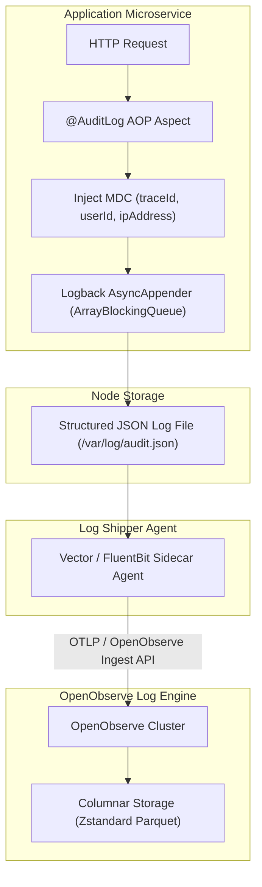
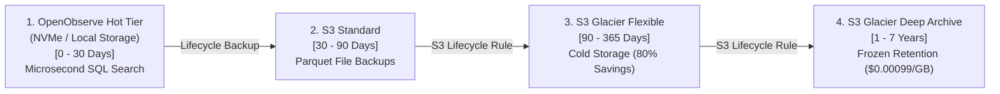

# 14. Enterprise Audit Logging, OpenObserve & S3 Glacier Archival Design

## 📖 Table of Contents
1. [Audit Logging vs. Application Logging](#1-audit-logging-vs-application-logging)
2. [Best Technical Architecture for Audit Logging](#2-best-technical-architecture-for-audit-logging)
3. [OpenObserve High-Scale Integration Pipeline](#3-openobserve-high-scale-integration-pipeline)
4. [High-Performance Asynchronous Logger Design (`MDC` + Logback JSON)](#4-high-performance-asynchronous-logger-design-mdc--logback-json)
5. [Log Lifecycle Archival Architecture (OpenObserve $\rightarrow$ S3 $\rightarrow$ Glacier)](#5-log-lifecycle-archival-architecture-openobserve-rightarrow-s3-rightarrow-glacier)

---

## 1. Audit Logging vs. Application Logging

| Feature | Application Debug Logs | Compliance Audit Logs |
| :--- | :--- | :--- |
| **Purpose** | System diagnostics & exception debugging. | Compliance, security tracing & legal accountability. |
| **Retention** | Short-term (7 to 30 days). | Long-term (1 to 7+ years compliance). |
| **Delivery Guarantee** | Best-effort (Sampling allowed during spikes). | **Zero-Loss Guarantee** (100% immutable delivery). |
| **Data Payload** | Stack traces, thread names, variable values. | Actor ID, Action, Resource ID, Timestamp, IP, Trace ID. |

---

## 2. Best Technical Architecture for Audit Logging



---

## 3. OpenObserve High-Scale Integration Pipeline

### Why OpenObserve over Elasticsearch?
- **140x Lower Storage Cost**: Built in Rust using Apache Arrow & Parquet columnar storage.
- **SQL Query Support**: Allows querying logs using standard SQL queries (`SELECT count(*), user_id FROM audit_logs WHERE status='FAILED' GROUP BY user_id`).

### The Vector Log Shipper Pattern:
Application threads should **NEVER make synchronous HTTP POST requests to OpenObserve directly** (which blocks threads and risks dropping logs during network partitions). Instead, microservices log to local disk, and a **Vector sidecar agent** reliably batches, compresses, and streams logs to OpenObserve.

---

## 4. High-Performance Asynchronous Logger Design (`MDC` + Logback JSON)

### Spring AOP Audit Annotation (`@AuditLog`):

```java
@Target(ElementType.METHOD)
@Retention(RetentionPolicy.RUNTIME)
public @interface AuditLog {
    String action();
    String resource();
}
```

### Aspect Implementation with MDC Context:

```java
@Aspect
@Component
public class AuditLoggingAspect {

    private static final Logger auditLogger = LoggerFactory.getLogger("AUDIT_LOGGER");

    @Around("@annotation(auditLog)")
    public Object logAudit(ProceedingJoinPoint joinPoint, AuditLog auditLog) throws Throwable {
        long startTime = System.currentTimeMillis();
        String traceId = UUID.randomUUID().toString();
        
        MDC.put("traceId", traceId);
        MDC.put("action", auditLog.action());
        MDC.put("resource", auditLog.resource());

        Object result;
        try {
            result = joinPoint.proceed();
            MDC.put("status", "SUCCESS");
        } catch (Throwable ex) {
            MDC.put("status", "FAILED");
            MDC.put("error", ex.getMessage());
            throw ex;
        } finally {
            long duration = System.currentTimeMillis() - startTime;
            MDC.put("durationMs", String.valueOf(duration));
            
            // Output structured audit event
            auditLogger.info("AUDIT_EVENT action={} resource={} status={}", 
                auditLog.action(), auditLog.resource(), MDC.get("status"));
            
            MDC.clear();
        }
        return result;
    }
}
```

---

## 5. Log Lifecycle Archival Architecture (OpenObserve $\rightarrow$ S3 $\rightarrow$ Glacier)

To balance microsecond search speed with ultra-low compliance storage cost, logs transition through **4 Tiering Stages**:



### AWS S3 Lifecycle Policy Configuration (`lifecycle-policy.json`):

```json
{
  "Rules": [
    {
      "ID": "AuditLogArchivalPolicy",
      "Status": "Enabled",
      "Filter": {
        "Prefix": "logs/audit/"
      },
      "Transitions": [
        {
          "Days": 30,
          "StorageClass": "STANDARD_IA"
        },
        {
          "Days": 90,
          "StorageClass": "GLACIER"
        },
        {
          "Days": 365,
          "StorageClass": "DEEP_ARCHIVE"
        }
      ],
      "Expiration": {
        "Days": 2555
      }
    }
  ]
}
```
