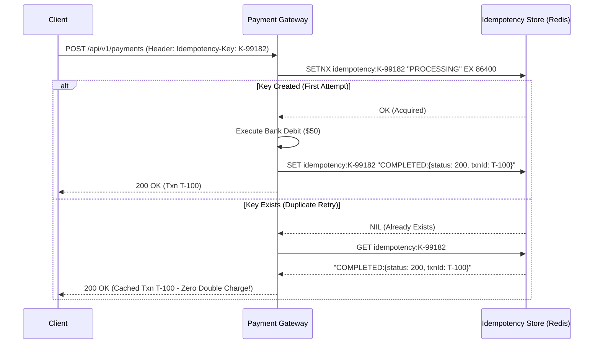
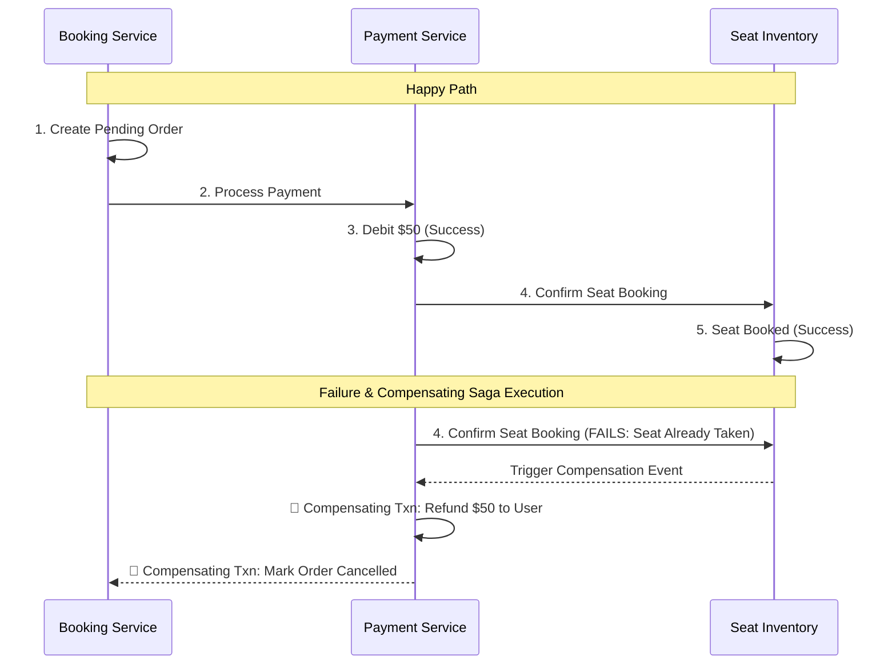

# 15. Payment Transaction Atomicity, Idempotency & Distributed Sagas

## 📖 Table of Contents
1. [The Distributed Payment Atomicity Problem](#1-the-distributed-payment-atomicity-problem)
2. [Idempotency Key Pattern (Preventing Double-Charging)](#2-idempotency-key-pattern-preventing-double-charging)
3. [Two-Phase Payment Reservation (Pre-Auth Hold & Capture)](#3-two-phase-payment-reservation-pre-auth-hold--capture)
4. [Distributed Transaction Patterns: 2PC vs Saga Pattern](#4-distributed-transaction-patterns-2pc-vs-saga-pattern)
5. [Transactional Outbox Pattern for Zero-Loss Payment Events](#5-transactional-outbox-pattern-for-zero-loss-payment-events)

---

## 1. The Distributed Payment Atomicity Problem

In microservices, a payment checkout touches multiple isolated databases across different networks:

```
[User App] ──> [Booking Service] ──> [Payment Gateway (Stripe/Bank)] ──> [Notification Service]
                     │                          │
                 [SQL DB]                  [Bank Ledger]
```

### 🔴 Partial Failure Scenario (Dual-Write Problem):
If money is debited from the user's bank account ($50), but a network timeout occurs before `movie-booking-service` commits the seat status to `BOOKED`:
- The user is **charged $50**, but **receives no ticket**.
- **Atomicity Violation**: A transaction MUST either succeed completely across all systems or fail completely with zero side effects.

---

## 2. Idempotency Key Pattern (Preventing Double-Charging)

When network timeouts occur, mobile clients automatically retry HTTP requests. Without idempotency, double-clicking "Pay Now" or client retries will **charge the user twice**!



---

## 3. Two-Phase Payment Reservation (Pre-Auth Hold & Capture)

Major booking platforms (Ticketmaster, BookMyShow, Airbnb) handle payments in **2 distinct phases**:

1. **Phase 1: Pre-Authorization Hold**:
   - The payment gateway places a temporary **hold (authorization)** on the customer's funds without debiting.
   - Concurrently, Redis places a 10-minute hold on the seat (`SET seat:A1 user_id NX PX 600000`).
2. **Phase 2: Capture or Void**:
   - If seat booking succeeds in SQL DB: Execute **Capture Command** to debit the authorized funds.
   - If booking fails or times out: Execute **Void Command** to cancel the hold instantly.

---

## 4. Distributed Transaction Patterns: 2PC vs Saga Pattern

### 2-Phase Commit (2PC) 🔴 (Avoid in High-Scale Microservices)
- Coordinates transactions across databases using a central Coordinator.
- **Drawback**: Holds DB row locks open across network boundaries, causing severe performance degradation and connection pool starvation under high traffic.

---

### Saga Pattern 🟢 (Production Standard)
Decomposes a distributed transaction into a sequence of **Local Transactions**. Each step updates its local DB and triggers the next step via events.

If any step fails, the Saga executes **Compensating Transactions** in reverse order:



---

## 5. Transactional Outbox Pattern for Zero-Loss Payment Events

To guarantee that payment events are **never lost** during application crashes, microservices use the **Transactional Outbox Pattern**:

```sql
-- Executed inside the SAME local SQL ACID transaction:
BEGIN TRANSACTION;

INSERT INTO bookings (id, user_id, show_id, status) 
VALUES ('B-100', 'U-50', 'SHOW-6PM', 'CONFIRMED');

INSERT INTO outbox_events (id, aggregate_type, aggregate_id, event_type, payload) 
VALUES ('E-991', 'BOOKING', 'B-100', 'BOOKING_CONFIRMED', '{"bookingId":"B-100"}');

COMMIT;
```

A background CDC (Change Data Capture) tool like **Debezium** tails the DB transaction log and streams events to **Apache Kafka** with 100% At-Least-Once delivery guarantee!
