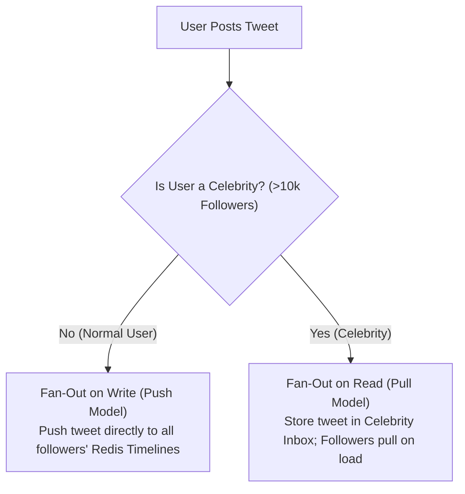

# 16. Real-World System Architectures & Enterprise Case Studies

## 📖 Table of Contents
1. [Facebook Architecture Case Studies (Haystack, TAO, Memcached)](#1-facebook-architecture-case-studies)
2. [Amazon Architecture Case Studies (Dynamo & Distributed KV Stores)](#2-amazon-architecture-case-studies)
3. [Google Architecture Case Studies (GFS, Bigtable, Differential Sync)](#3-google-architecture-case-studies)
4. [Twitter / X Architecture Case Studies (Hybrid Fan-Out, Snowflake ID Generator)](#4-twitter--x-architecture-case-studies)
5. [Netflix Architecture Case Studies (Chaos Engineering & Microservice Stack)](#5-netflix-architecture-case-studies)
6. [Uber & WhatsApp Scale Case Studies (Real-Time DISCO Market & Erlang BEAM)](#6-uber--whatsapp-scale-case-studies)

---

## 1. Facebook Architecture Case Studies

### 🖼️ Facebook Haystack (Photo Storage System)
- **The Problem**: Traditional Linux filesystems (`ext4`) store metadata separately from file data. Fetching a photo required 3-4 disk I/O operations (`directory inode` $\rightarrow$ `file inode` $\rightarrow$ `block offset`). Under billions of photo views, metadata disk seeks bottlenecked the system.
- **The Solution**: Haystack packs millions of photos into single multi-gigabyte **Volume Files**. All photo offsets, sizes, and metadata keys are cached in RAM.
- **Key Takeaway**: Reduced disk seeks to **exactly 1 disk read per photo request** (100% throughput gain).

### 🕸️ Facebook TAO (Distributed Social Graph Store)
- **The Problem**: Social graph queries ("Find all friends who commented on photos liked by User A") required expensive SQL `JOIN` queries across thousands of MySQL shards.
- **The Solution**: Built **TAO**, a distributed graph data store using **Nodes** (Users, Photos, Comments) and **Edges** (Friend-of, Liked-by, Authored-by).
- **Key Takeaway**: Uses a 2-tier cache hierarchy (Leader-Follower cache) with write-through replication and asynchronous consistency.

### ⚡ Scaling Memcached at Facebook
- **The Problem**: Handling billions of cache requests per second caused Thundering Herd effects and connection pool exhaustion.
- **The Solution**: Built **Mcrouter** (proxy layer), used **UDP for read requests** (eliminating TCP handshake overhead), and introduced **Lease Tokens** to prevent cache stampedes.

---

## 2. Amazon Architecture Case Studies

### 🔑 Amazon DynamoDB (Dynamo Paper Principles)
- **Consistent Hashing with Virtual Nodes**: Keys are assigned to a 128-bit ring space. Virtual nodes ensure uniform partition distribution and effortless node additions without massive re-sharding.
- **Configurable Quorum ($N, W, R$)**:
  - $N$: Replication factor (number of nodes storing a key).
  - $W$: Write quorum (number of nodes that must acknowledge a write).
  - $R$: Read quorum (number of nodes that must respond to a read).
  - **Rule**: If $W + R > N$, the system guarantees **Strong Consistency**. If $W + R \le N$, the system provides **Eventual Consistency**.
- **Vector Clocks & Sloppy Quorums**: Used for client-side conflict resolution during concurrent network partitions.
- **Merkle Trees**: Tree of cryptographic hashes used for rapid background data synchronization between replicas (Anti-Entropy).

---

## 3. Google Architecture Case Studies

### 📁 Google File System (GFS) & Bigtable
- **GFS Architecture**: Single Master node + thousands of Chunkservers. Files split into **64MB chunks**. Master keeps metadata in RAM for microsecond lookups; clients stream bulk data directly from Chunkservers.
- **Bigtable LSM Tree Compaction**: Sparse 3D map indexed by `(row_key, column_key, timestamp)`. Writes land in **MemTable (RAM)** + **WAL (Disk)** and are flushed asynchronously as immutable **SSTables**. Background threads compact SSTables to maintain $O(\log N)$ search speed.

### 🔄 Google Docs Differential Synchronization
- **The Problem**: Multiple users editing the exact same document simultaneously over high-latency networks.
- **The Solution**: Uses **Differential Synchronization (Diff, Patch, Shadow)**. Rather than sending whole document states, clients send differential patches against a local shadow copy. The server applies patches using Operational Transformation (OT) to guarantee eventual convergence across all devices.

---

## 4. Twitter / X Architecture Case Studies

### 📣 Hybrid Fan-Out Strategy (Home Timeline Engine)



- **Fan-Out on Write (Push)**: For normal users ($\le 10,000$ followers). When User A tweets, a background worker pushes the tweet ID directly into the Redis timeline cache of all followers.
- **Fan-Out on Read (Pull)**: For celebrities (e.g., 100M followers). Pushing to 100M caches would crash the system! Instead, celebrity tweets are stored in a standalone buffer. When a user opens their timeline, the system **pulls and merges** celebrity tweets dynamically.

### ❄️ Twitter Snowflake (Distributed Unique ID Generator)
Generates 64-bit time-sortable globally unique IDs without central database locks:

```
┌─────────────────┬──────────────────────────────┬──────────────────┬─────────────────┐
│ 1 Bit (Sign)    │ 41 Bits (Timestamp in ms)    │ 10 Bits (Machine)│ 12 Bits (Seq)   │
└─────────────────┴──────────────────────────────┴──────────────────┴─────────────────┘
```
- **41 Bits Timestamp**: Supports 69 years of unique timestamps.
- **10 Bits Machine ID**: Supports 1,024 machine worker nodes.
- **12 Bits Sequence Number**: Allows **4,096 unique IDs per millisecond per node**!

---

## 5. Netflix Architecture Case Studies

### 🐒 Microservice Resilience & Chaos Engineering
- **Chaos Engineering (Chaos Monkey / Simian Army)**: Randomly terminates production microservice instances during business hours to force engineers to build fault-tolerant systems.
- **Full Stack Resilience**:
  - Eureka (Service Discovery)
  - Zuul / Spring Cloud Gateway (API Gateway & Throttling)
  - Resilience4j / Hystrix (Circuit Breakers & Fallbacks)
  - Chaos Mesh (Fault Injection)

---

## 6. Uber & WhatsApp Scale Case Studies

### 🚕 Uber DISCO & Ringpop (Real-Time Location Matching)
- **Ringpop**: Consistent Hashing Ring protocol built on a Gossip membership protocol. Maps driver IDs to specific node partitions.
- **Uber H3**: Hexagonal spatial index for mapping driver coordinates to 16-level resolution hexagons.

### 💬 WhatsApp $19 Billion Architecture (Erlang BEAM Engine)
- **Scale**: 2 Billion Users managed by only **50 Software Engineers**!
- **Secret Weapon**: **Erlang BEAM Virtual Machine**. Uses lightweight actor processes (~2KB memory per process).
- **Network Tuning**: Tuned FreeBSD kernel to support **2 Million concurrent raw TCP connections per single server node**!
