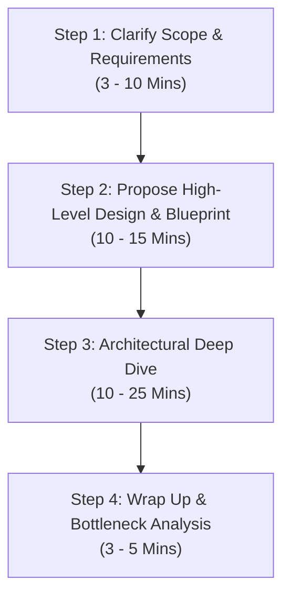
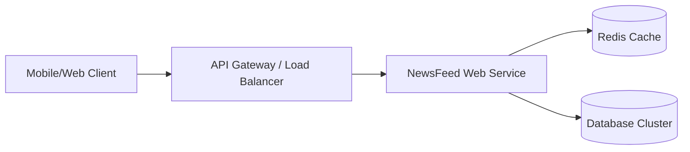

# 18. The 4-Step Framework for System Design Interviews

## 📖 Table of Contents
1. [The Mindset & Evaluation Criteria](#1-the-mindset--evaluation-criteria)
2. [The 4-Step Interview Framework](#2-the-4-step-interview-framework)
3. [Step 1: Understand the Problem & Establish Design Scope](#step-1-understand-the-problem--establish-design-scope)
4. [Step 2: Propose High-Level Design & Get Buy-In](#step-2-propose-high-level-design--get-buy-in)
5. [Step 3: Architectural Deep Dive](#step-3-architectural-deep-dive)
6. [Step 4: Wrap Up & Bottleneck Analysis](#step-4-wrap-up--bottleneck-analysis)
7. [Interview Dos & Don'ts Checklist](#7-interview-dos--donts-checklist)

---

## 1. The Mindset & Evaluation Criteria

A System Design interview is **not a trivia test**—it simulates real-life engineering collaboration where two co-workers brainstorm an ambiguous, open-ended problem.

### 🎯 What Interviewers Look For:
1. **Communication & Collaboration**: Treating the interviewer as a teammate and bouncing ideas constructively.
2. **Handling Ambiguity**: Asking targeted questions to narrow down broad requirements.
3. **Pragmatic Trade-off Analysis**: Avoiding over-engineering red flags (over-complicated architectures for modest scales).

---

## 2. The 4-Step Interview Framework

---

## 3. Step 1: Understand the Problem & Establish Design Scope (3 – 10 Mins)

### ⚠️ Rule #1: Don't Be "Jimmy"!
Never jump straight to drawing boxes or giving a solution without asking clarifying questions. Jumping in blind is a major red flag.

### ❓ Essential Clarifying Questions to Ask:
- **Clients**: Is this a Mobile App (iOS/Android), Web App, or both?
- **Features**: What are the core MVP features vs out-of-scope features?
- **Scale**: What is the DAU / MAU? What is the expected 3-month and 1-year scale?
- **Media**: Does the system handle text-only, or media (images, 4K videos)?
- **Ordering**: Is data sorted reverse-chronologically or via machine-learning ranking?

---

## 4. Step 2: Propose High-Level Design & Get Buy-In (10 – 15 Mins)

1. **Draw High-Level Component Diagrams**:
   - Clients $\rightarrow$ Load Balancers / API Gateway $\rightarrow$ Application Web Servers $\rightarrow$ Cache $\rightarrow$ Databases $\rightarrow$ Message Queues.
2. **Execute Back-of-the-Envelope Math**:
   - Verify QPS, Peak QPS, and Storage bandwidth against the drawn components.
3. **Trace End-to-End User Flows**:
   - Trace the happy-path data flow for primary use-cases (e.g. *Publish Post Flow* vs *Retrieve News Feed Flow*).

---

## 5. Step 3: Architectural Deep Dive (10 – 25 Mins)

Identify 2-3 critical components with the interviewer and drill down:

- **URL Shortener**: Deep dive into Hash functions (Base62 vs MD5/SHA-256) and collision handling.
- **Chat Application**: Deep dive into WebSocket connection management, heartbeats, and Online/Offline presence queues.
- **News Feed System**: Deep dive into **Fan-Out on Write (Push)** vs **Fan-Out on Read (Pull)** strategies.

---

## 6. Step 4: Wrap Up & Bottleneck Analysis (3 – 5 Mins)

- **Identify Single Points of Failure (SPOFs)** and discuss active-standby failover.
- **Critical Metrics & Monitoring**: How to monitor latency percentiles ($P_{99}, P_{99.9}$), CPU saturation, and DB connection pools using Prometheus/Grafana.
- **Future Scaling**: Discuss what changes are needed to scale from 1 Million to 10 Million DAU.

---

## 7. Interview Dos & Don'ts Checklist

| ✅ DOS | ❌ DON'TS |
| :--- | :--- |
| **Always ask clarifying questions** before designing. | Don't jump into a solution without clarifying requirements. |
| **State assumptions explicitly** and write them down. | Don't think in silence—communicate out loud continuously. |
| **Treat interviewer as a teammate** and bounce ideas off them. | Don't be defensive or stubborn when receiving feedback. |
| **Start high-level** before diving into minute component details. | Don't over-engineer simple problems for modest traffic. |
