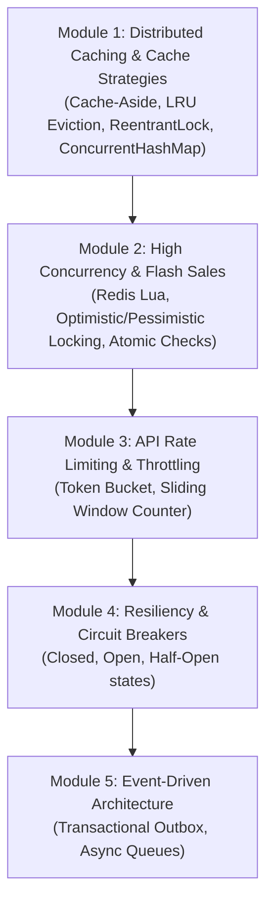

# 📜 Session Transcript & Comprehensive Study Log

**Session Date**: August 1-2, 2026  
**Topic**: System Design & Concurrency Foundations (Module 1)  
**Project**: `/Users/rahul.jain/Desktop/projects/Booking`  

---

## 1. System Design Learning Roadmap & Curriculum



---

## 2. Comprehensive Q&A & Technical Deep Dives

### Q1: How should we structure the Cache implementation?
> **Answer**: Use a generic `Cache<K, V>` interface and `LruCache<K, V>` implementation (Separation of Concerns). Then use the **Decorator Pattern** (`CachingPromotionRepository`) to wrap database repositories.

### Q2: How does Per-Entry TTL work?
> **Answer**: Store an absolute expiration timestamp (`System.currentTimeMillis() + ttlMillis`) in the internal `Node<K, V>` structure. On `get(K key)`, lazily check if `node.isExpired()`. If expired, evict and return `Optional.empty()`.

### Q3: What are `ReentrantLock` and `ReentrantReadWriteLock`?
> **Answer**:
> - **Reentrant**: A thread holding the lock can re-acquire it without deadlocking itself.
> - **ReentrantReadWriteLock**: Splits into a shared `ReadLock` (multiple readers) and exclusive `WriteLock` (single writer).
> - *LRU Catch*: In an LRU Cache, `get()` updates LRU ordering pointers (`head`, `prev`, `next`), so `get()` mutates shared state and requires lock synchronization (`ReentrantLock` or `writeLock`).

### Q4: What are "Buckets" in `ConcurrentHashMap`?
> **Answer**: A **bucket** is a slot in the map's internal array (`Node<K, V>[]`). Keys are mapped to buckets via `hash(key) % array.length`.
> - **Hash Collisions**: Handled by chaining entries inside the bucket using a **LinkedList** (or **Red-Black Tree** if bucket size > 8).
> - **Fine-Grained Bucket Locking**: Java 8+ `ConcurrentHashMap` locks *only* the specific bucket head node being modified, allowing all other buckets to be read/written concurrently.

### Q5: What is the best Doubly-Linked List approach for LRU Cache in Java?
> **Answer**:
> - Built-in `java.util.LinkedList` is **NOT** suitable for $O(1)$ LRU Cache because its `Node` class is private, forcing $O(N)$ linear scans during `remove()`.
> - **Best Approach**: Use a **Custom Inner `Node<K, V>` class** stored directly in `HashMap<K, Node<K, V>>`, enabling true $O(1)$ pointer re-linking.
> - **Built-in Alternative**: `java.util.LinkedHashMap` initialized with `accessOrder = true`.

### Q6: Should `hitCount` and `missCount` be `volatile` or `AtomicLong`?
> **Answer**: Use **`AtomicLong`** (or Java 8's **`LongAdder`**). `volatile` does not make compound operations (`hitCount++`) atomic, causing lost updates under race conditions. `AtomicLong` uses hardware CAS instructions.

### Q7: What does the `clear()` function do and why `head.next = tail; tail.prev = head;`?
> **Answer**: `clear()` flushes all cached items. It uses **Dummy Sentinel Nodes** (`head` and `tail`) which eliminate `NullPointerException` checks. Resetting `head.next = tail` and `tail.prev = head` severs all pointer references, allowing Java's Garbage Collector (GC) to reclaim memory for all orphaned nodes.

### Q8: Custom `LruCache` vs `ConcurrentHashMap` vs `Caffeine`?
> **Answer**:
> - **Caffeine**: Production standard (uses Window TinyLFU, lock-free ring buffers, up to 30% higher hit ratio).
> - **Custom LRU Cache**: Essential for LLD & System Design interviews to prove deep understanding of data structures, concurrency, and pointer manipulation.

---

## 3. GitHub & Local Workspace Setup
- Installed `gh` CLI via Homebrew.
- Project repo initialized at `/Users/rahul.jain/Desktop/projects/Booking`.
- Study notes persisted at `.learn/.docs/` inside the project workspace.

---

## 4. Refactored Thread-Safe LRU Cache & Concurrency Insights

### Q9: Why was `ReentrantReadWriteLock` replaced with `ReentrantLock` in `LruCache`?
> **Answer**: In an LRU cache, calling `get(key)` modifies doubly-linked list pointers (`moveToHead`) to move the item to MRU. Since `get()` performs memory mutations on shared pointers, a `ReadLock` is unsafe under multi-threaded concurrency. Replacing it with a single `ReentrantLock` creates a unified atomic lock domain over both `ConcurrentHashMap` and `LruLinkedList`.

### Q10: How does `addToHead(node)` correctly connect doubly-linked list pointers?
> **Answer**: All 4 pointers must be updated atomically:
> ```java
> LruNode<K,V> prev = head.prev;
> node.prev = prev;
> prev.next = node;
> head.prev = node;
> node.next = head;
> ```
> This guarantees `prev <---> node <---> head` continuity without orphan references.

### Q11: How is memory cleaned up during eviction?
> **Answer**: `lruList.removeFromTail()` severs list references and returns the evicted node's `key`. `LruCache.put()` then executes `map.remove(evictedKey)`, preventing memory leaks in `ConcurrentHashMap`.

### Q12: How is lazy TTL expiration handled?
> **Answer**: On `get(K key)`, if `System.currentTimeMillis() > node.ttl`, both `map.remove(key)` and `lruList.removeNode(node)` are called immediately, returning `null` / `Optional.empty()`.

### Q13: What is the Adapter Design Pattern and how does `CaffeineCacheAdapter` apply it?
> **Answer**: The **Adapter Pattern** converts the interface of a class into another interface clients expect. `CaffeineCacheAdapter` implements our custom `Cache<K, V>` interface while wrapping an internal `com.github.benmanes.caffeine.cache.Cache` instance. This allows our application to switch between `LruCache` and `CaffeineCacheAdapter` seamlessly without modifying business logic.

### Q14: How does Caffeine's W-TinyLFU eviction algorithm outperform LRU?
> **Answer**: LRU only considers *recency*, making it vulnerable to cache pollution during single burst scans. **W-TinyLFU (Window TinyLFU)** tracks both *Frequency* and *Recency* using a probabilistic Count-Min Sketch (~8 bits per item). It achieves up to **30% higher hit rates** than LRU.

### Q15: Why is Caffeine lock-free during read operations?
> **Answer**: Custom LRUs acquire locks on `get()` because list pointer updates mutate memory. Caffeine uses **Lock-Free Ring Buffers** (inspired by the LMAX Disruptor architecture). Reads log events into ring buffers without locking, and a background thread batch-updates eviction metadata.

### Q16: What is the Decorator Design Pattern and how does `CachingPromotionRepository` implement Cache-Aside?
> **Answer**: The **Decorator Pattern** dynamically attaches additional responsibilities to an object without modifying its structure. `CachingPromotionRepository` decorates `PromotionRepository` (Spring Data JPA) by intercepting calls: on read miss, it queries JPA, populates `Cache<String, PromotionDefinition>`, and returns; on write, it updates the JPA database and updates the cache.

---

## 5. Module 2: High Concurrency & Flash Sale Reservation Architecture

### Q17: What is the main bottleneck of Pessimistic Locking (`SELECT ... FOR UPDATE`) under high traffic?
> **Answer**: Pessimistic locking holds exclusive database row locks for the entire duration of a transaction. Under 50,000 requests/sec, this leads to **Database Connection Pool Exhaustion** (starving HikariCP pools), high request latency, and risk of **Deadlocks** when locking multiple rows in different order.

### Q18: How does Optimistic Locking (`@Version` / CAS) improve throughput?
> **Answer**: Optimistic locking avoids DB row locks completely during reads. On write, it appends `WHERE version = expected_version` to the `UPDATE` query. If another transaction updated the row first, the version mismatch causes zero rows to be updated and Spring throws an `OptimisticLockingFailureException`.

### Q19: Why is Redis Lua Scripting ideal for Flash Sales and Seat Reservations?
> **Answer**: Redis runs commands single-threaded in an event loop. A Lua script executes atomically without any other command interrupting it. This allows performing microsecond-level atomic **check-and-set** (e.g. check inventory > 0, decrement counter, return result) without database locks or thread blocking.

### Q20: What is a Redisson Distributed Lock and how does the Watchdog mechanism work?
> **Answer**: Redisson provides a distributed mutex lock across isolated JVM app servers using Redis. Its **Watchdog mechanism** spawns a background timer that periodically auto-extends the lock TTL (`PEXPIRE`) every 10 seconds as long as the holding thread is active, preventing premature lock expiration during long operations.

### Q21: How do major booking platforms (BookMyShow, Ticketmaster) handle reservations across multiple apps (Paytm, Web, Mobile)?
> **Answer**: They use a **Two-Phase Seat Reservation Architecture**: Phase 1 places an atomic temporary hold in Redis using `SET key value NX PX 600000` (10-minute TTL). Phase 2 commits the permanent booking to the primary database upon payment success. If payment is abandoned, Redis auto-expires the key without needing database cleanup.

### Q22: What happens when 3 users click the same seat at the exact same millisecond across different apps?
> **Answer**: The 3 app servers send parallel `SET seat:A1 user_id NX PX 600000` commands to Redis. Because Redis executes single-threaded, the event loop processes the 1st request, creates the key, and returns `OK`. The 2nd and 3rd requests find the key already existing; because of the `NX` (Not eXists) flag, Redis rejects them returning `NIL`. User 1 gets the 10-minute hold; Users 2 & 3 receive immediate "Seat Taken" popups.

### Q23: How should Redisson `tryLock` be structured in code to avoid race conditions and illegal monitor state exceptions?
> **Answer**: Always check `if (!isAcquired)` immediately after `lock.tryLock(waitTime, leaseTime, unit)` to fail fast if the lock was not acquired. Place all database operations inside the `try` block while the lock is held. In the `finally` block, check `if (isAcquired && lock.isHeldByCurrentThread())` before calling `lock.unlock()` to ensure only the owner thread releases the lock safely.

---

## 6. Multi-Threading & Synchronous vs Asynchronous Execution Architecture

### Q24: What is the main difference between Synchronous (Blocking) and Asynchronous (Non-Blocking) execution?
> **Answer**: Synchronous execution blocks the calling thread while waiting for I/O (DB, HTTP APIs, Email) to complete, taking linear accumulated latency. Asynchronous execution offloads I/O tasks to background workers / event queues (`CompletableFuture`), returning an immediate response (`202 Accepted`) to the caller.

### Q25: What are the 4 Thread Rejection Policies in `ThreadPoolExecutor`?
> **Answer**: When work queues fill up:
> 1. `AbortPolicy` (default): Throws `RejectedExecutionException`.
> 2. `CallerRunsPolicy`: The thread calling `.execute()` runs the task itself, applying natural **Backpressure**.
> 3. `DiscardOldestPolicy`: Drops the oldest task in queue to make room for the new task.
> 4. `DiscardPolicy`: Silently drops the new task.

### Q26: When do Java 21 Virtual Threads provide massive throughput speedups vs when do they provide ZERO benefit?
> **Answer**: Virtual threads yield massive throughput speedups (100x) for **I/O-bound workloads** (SQL DB, REST APIs, Redis) because the JVM unmounts the virtual thread from the OS carrier thread during I/O waits. For **CPU-bound workloads** (encryption, math, sorting), virtual threads provide **zero benefit** because CPU execution cannot unmount without I/O yield points.

### Q27: What is Thread Pinning in Java 21 Virtual Threads?
> **Answer**: Thread pinning occurs when a Virtual Thread executes inside a `synchronized` block/method or Native C (JNI) call. During pinning, the Virtual Thread cannot unmount from the underlying OS carrier thread during I/O, defeating the purpose of virtual threads. *Solution*: Replace `synchronized` with `ReentrantLock`.

---

## 7. API Rate Limiting & Throttling Architecture

### Q28: How does the Token Bucket algorithm work and why is Lazy Refill Math used in production?
> **Answer**: The Token Bucket algorithm allows burst capacity up to a maximum limit while refilling tokens at a constant rate per second. **Lazy Refill Math** computes refilled tokens on-demand (`nanosPassed * refillRatePerNano`) whenever a request arrives rather than running background threads, providing microsecond-level performance with zero CPU overhead.

### Q29: What is the Border Burst Problem in the Fixed Window Counter algorithm?
> **Answer**: In Fixed Window Counter, time is split into static intervals (e.g. 12:00:00 - 12:01:00). A user can send 100 requests at 12:00:59 and another 100 requests at 12:01:01, effectively sending **200 requests in 2 seconds** across the window boundary, breaking the 100 req/min limit. *Solution*: Use Token Bucket or Sliding Window Counter.

### Q30: How does a Spring `OncePerRequestFilter` handle rate limiting rejection?
> **Answer**: The filter extracts the client IP address (from `X-Forwarded-For` or `getRemoteAddr()`). If `rateLimiter.tryAcquire(clientIp)` returns `false`, the filter aborts execution before reaching controllers, sets HTTP status `429 (TOO_MANY_REQUESTS)`, sets `Content-Type: application/json`, and returns a JSON error response.

---

## 8. DropBox / Cloud File Storage System Design

### Q31: Why are files split into 4MB chunks in DropBox / Google Drive System Design?
> **Answer**: Splitting files into fixed 4MB chunks enables **Delta Sync** (uploading only modified 4MB chunks when editing a 1GB file), **Parallel Chunk Uploads** over multiple TCP connections, and **Resume on Failure** without restarting the entire file upload.

### Q32: How does Hash-based Chunk Deduplication work across millions of users?
> **Answer**: Each 4MB chunk is cryptographically hashed with SHA-256. Before uploading, the client sends the 64-character SHA-256 hash list to the Metadata Server. If the hash already exists in S3 (uploaded by any user globally), the Block Server skips the 4MB payload upload completely and simply links the metadata record to the existing block.

### Q33: How does the DropBox Client Sync Engine detect local file changes instantly?
> **Answer**: The client Sync Engine uses OS-level File System Watcher APIs (`FSEvents` on macOS, `inotify` on Linux, `ReadDirectoryChangesW` on Windows). When a file changes, the Watcher triggers the local Indexer (SQLite DB) and Chunker to process modified 4MB blocks.

### Q34: What is the role of the Notification Service in Cloud File Storage System Design?
> **Answer**: The Notification Service maintains persistent HTTP/2 or WebSocket connections to all active client devices. When a file is updated on Device A, the Metadata Server publishes an update event to the Notification Service, which immediately pushes a sync signal to Device B to pull the new chunks.

---

## 9. Real-Time Delivery & Driver Location Tracking System Design

### Q35: How is a Location Ingestion Pipeline architected for 1 Million active drivers sending GPS pings every 4 seconds?
> **Answer**: Driver GPS pings ($250,000 \text{ req/sec}$) are accepted by lightweight, stateless API Gateways and pushed directly to an **Apache Kafka Partitioned Topic**. Worker consumer groups read location batches asynchronously and update an in-memory **Redis Geospatial Cluster** (`GEOADD`), avoiding database bottlenecks.

### Q36: What is the difference between Geohash, QuadTree, and Uber H3 Spatial Indexing?
> **Answer**: 
> - **Geohash**: Encodes 2D lat/lng into a Base32 string grid. Subject to edge distortion across grid borders.
> - **QuadTree**: 2D tree where each node splits into 4 sub-quadrants, dynamically partitioning dense urban areas vs sparse rural areas.
> - **Uber H3**: Hexagonal spatial grid system where all 6 neighboring cells have identical center point distance, making radius queries and spatial aggregation mathematically uniform.

### Q37: How do food delivery apps (Swiggy, Zomato, UberEats) render smooth vehicle movement between 4-second GPS pings?
> **Answer**: They use **Dead Reckoning & Map Matching** on the client UI. The app snaps raw GPS coordinates to road vectors on maps (Map Matching) and interpolates movement using vehicle speed and heading angle (Dead Reckoning) to animate the bike smoothly between 4-second network updates.

### Q38: How does Redis Geospatial index location data for fast radius queries?
> **Answer**: Redis Geospatial commands (`GEOADD`, `GEORADIUS`, `GEOSEARCH`) convert 2D latitude/longitude coordinates into 52-bit integers using **Geohashing**, and store them in a **Redis Sorted Set (ZSET)**. This enables $O(\log N + M)$ range queries for finding drivers within $X$ km.

---

## 10. Bit Manipulation & Math Problem Solving

### Q39: How do you sum two integers without using `+` or `-` operators?
> **Answer**: Use bitwise XOR (`a ^ b`) to compute the sum without carries, and bitwise AND with left shift `(a & b) << 1` to compute the carry. Repeat `a = a ^ b` and `b = (a & b) << 1` iteratively until `b == 0`.

### Q40: How do you find the smallest number $\ge n$ whose digit product is divisible by $t$?
> **Answer**: Increment candidate number $x = n, n+1, n+2, \dots$ and compute digit product `product *= (temp % 10)` for each. Check `product % t == 0`. Any candidate containing digit `0` has product `0` ($0 \pmod t = 0$), guaranteeing convergence within at most 10 iterations.

---

## 11. Enterprise Audit Logging, OpenObserve & S3 Glacier Archival Design

### Q41: Why should application microservices NEVER send audit logs synchronously to OpenObserve over HTTP?
> **Answer**: Making synchronous HTTP POST requests to OpenObserve blocks application worker threads, increasing API request latency by 100ms+ and risking thread exhaustion/cascading failures if OpenObserve is down or experiencing network partitions.

### Q42: What is the recommended technical design pattern for high-scale microservice logging?
> **Answer**: Use **Asynchronous Local Logging with a Log Shipper Agent (Vector / FluentBit)**. The application writes JSON log events to a local disk file using non-blocking memory buffers (`Logback AsyncAppender`). A lightweight sidecar daemon (Vector) tails the file, compresses log batches, and streams them asynchronously to OpenObserve.

### Q43: How does MDC (Mapped Diagnostic Context) enable distributed tracing in Audit Logging?
> **Answer**: `MDC` stores contextual metadata (`traceId`, `userId`, `clientIp`, `action`) in ThreadLocal variables. When a log statement executes, MDC automatically injects these fields into the structured JSON log output, allowing seamless correlation across distributed microservices.

### Q44: What makes OpenObserve up to 140x more storage-efficient than Elasticsearch?
> **Answer**: OpenObserve is built in Rust using **Apache Arrow & Parquet Columnar Storage** compressed with **Zstandard (zstd)**, stored directly on object stores (S3). Unlike Elasticsearch's heavy inverted text indices, OpenObserve's columnar layout drastically reduces disk memory while enabling SQL search queries.

### Q45: How is log lifecycle tiering configured from OpenObserve to S3 Glacier Deep Archive?
> **Answer**: Logs transition across 4 storage tiers via AWS S3 Lifecycle Policies:
> 1. **Hot Tier (0-30 Days)**: OpenObserve local NVMe / S3 Hot for instant microsecond SQL queries.
> 2. **Warm Tier (30-90 Days)**: S3 Standard-Infrequent Access (S3 Standard-IA).
> 3. **Cold Tier (90-365 Days)**: S3 Glacier Flexible Retrieval (80% cost reduction).
> 4. **Frozen Compliance Tier (1-7 Years)**: S3 Glacier Deep Archive ($0.00099/GB/month) for legal compliance retention.

### Q46: How does Spring AOP `@AuditLog` simplify audit logging implementation?
> **Answer**: An AOP Aspect (`@Around("@annotation(AuditLog)")`) intercepts annotated business methods automatically. It captures method inputs/outputs, captures execution timing, extracts security context, populates MDC variables, and outputs structured audit JSON logs without polluting core domain code.

---

## 12. Payment Transaction Atomicity, Idempotency & Distributed Sagas

### Q47: What is the Partial Failure / Dual-Write Problem in Distributed Payment Systems?
> **Answer**: In microservices, updating a database and debiting a bank account occur over separate networks. If the bank debits funds ($50) but the network connection drops before the booking service updates seat status, the transaction suffers partial failure, violating ACID atomicity.

### Q48: How does the Idempotency Key Pattern prevent double-charging on client retries?
> **Answer**: Every payment request carries a unique `Idempotency-Key` header (UUID). The Payment Gateway executes `SETNX idempotency:key "PROCESSING" EX 86400` in Redis. On duplicate retries (e.g. double-clicking "Pay Now"), Redis finds the key existing and returns the cached payment response without re-debiting the user's card.

### Q49: How does Two-Phase Payment Reservation (Pre-Auth Hold & Capture) work?
> **Answer**: Phase 1 places an atomic **Pre-Authorization Hold** on the user's credit card and a 10-minute hold on the seat in Redis. Once seat allocation commits to the primary SQL DB, Phase 2 executes the **Capture Command** to debit funds. If seat booking fails, Phase 2 executes **Void/Cancel** to release the hold instantly.

### Q50: Why should 2-Phase Commit (2PC) be avoided in high-throughput microservices?
> **Answer**: 2PC relies on a central coordinator holding open SQL database row locks across multiple microservice databases throughout network calls. Under high traffic, this causes severe lock contention, thread starvation, and catastrophic database pool exhaustion.

### Q51: How does the Saga Pattern manage distributed payment transactions?
> **Answer**: A Saga breaks a distributed transaction into a chain of local ACID transactions. Each local transaction updates its database and emits an event. If a step fails (e.g. seat inventory full), the Saga executes **Compensating Transactions** in reverse order (e.g. `RefundPaymentCommand`, `CancelOrderCommand`) to restore data consistency.

### Q52: How does the Transactional Outbox Pattern guarantee zero event loss?
> **Answer**: The application writes entity state AND outbox event records into local SQL tables inside the **SAME ACID transaction** (`INSERT INTO outbox_events`). A Change Data Capture daemon (Debezium) reads the database write-ahead log (WAL) and streams events to Kafka with 100% At-Least-Once delivery guarantee.

---

## 13. Real-World System Architectures & Enterprise Case Studies

### Q53: How does Facebook Haystack achieve 1 disk seek per photo read under billions of photo uploads?
> **Answer**: Haystack packs millions of photos into single multi-gigabyte **Volume Files** and caches photo offsets, sizes, and file keys in RAM. This eliminates directory/inode metadata lookups, reducing disk seeks from 3-4 down to **exactly 1 disk seek per photo read**.

### Q54: How does Facebook TAO scale social graph queries compared to relational databases?
> **Answer**: TAO represents data as **Nodes** (Objects) and **Edges** (Associations), avoiding expensive SQL joins across MySQL shards. It uses a 2-tier write-through cache hierarchy with asynchronous follower-to-leader replication.

### Q55: How does Amazon Dynamo guarantee configurable consistency using Sloppy Quorum ($N, W, R$)?
> **Answer**: Dynamo uses configurable parameters $N$ (Replication Factor), $W$ (Write Quorum), and $R$ (Read Quorum). If $W + R > N$, reads and writes overlap, guaranteeing **Strong Consistency**. If $W + R \le N$, the system operates in **Eventual Consistency** mode for maximum availability.

### Q56: How does Twitter / X resolve timeline fan-out bottlenecks for celebrities vs normal users?
> **Answer**: Twitter uses a **Hybrid Fan-Out Strategy**:
> - **Normal Users ($\le 10k$ followers)**: Uses **Fan-Out on Write (Push)**, pushing tweets directly to all followers' Redis timelines.
> - **Celebrities ($> 100M$ followers)**: Uses **Fan-Out on Read (Pull)**, storing celebrity tweets in an isolated inbox and merging them dynamically when followers open their home timelines.

### Q57: How does Twitter Snowflake generate 64-bit globally unique, time-sortable IDs without central database locks?
> **Answer**: Snowflake IDs consist of: `[1 bit sign] [41 bits timestamp in ms] [10 bits worker node ID] [12 bits sequence number]`. This enables up to **4,096 unique, time-sortable IDs per millisecond per node** with zero cross-network locking.

### Q58: How does Google Docs Differential Synchronization guarantee real-time collaborative editing?
> **Answer**: Clients and servers maintain shadow document copies. When edits occur, clients compute text diffs and send lightweight patches (Operational Transformation). The server applies patches asynchronously to guarantee eventual convergence across high latency connections.

### Q59: What is Chaos Engineering at Netflix?
> **Answer**: Chaos Engineering (e.g. Chaos Monkey) intentionally injects random infrastructure failures (shutting down microservices, killing AWS instances, injecting network latency) in production during business hours to ensure services self-heal automatically without user disruption.

### Q60: How did WhatsApp support 2 Billion users with only 50 software engineers?
> **Answer**: WhatsApp built its core messaging stack on the **Erlang BEAM Virtual Machine** (Actor model with lightweight ~2KB processes) and tuned the FreeBSD kernel to support **2 Million concurrent raw TCP connections per single server node**.

---

## 14. Message Queue vs Pub-Sub Architecture

### Q61: What is the main difference between a Message Queue and a Pub-Sub (Publish-Subscribe) model?
> **Answer**: A Message Queue uses **1-to-1 Point-to-Point delivery** (1 message is processed and acknowledged by exactly 1 worker, then deleted). Pub-Sub uses **1-to-Many Fan-Out delivery** (1 message published to a Topic is replicated and delivered to all independent subscribers).

### Q62: Why do multiple workers listen to the same Message Queue in production?
> **Answer**: Multiple workers listen to the same queue to implement the **Competing Consumers Pattern**. Workers compete for tasks, providing automatic load balancing and worker parallelism (e.g. AWS SQS processing PDF generation jobs).

### Q63: How does Apache Kafka combine the advantages of Message Queues and Pub-Sub?
> **Answer**: Kafka uses **Consumer Groups** and **Partitions**. Within a Consumer Group, each partition is assigned to 1 consumer (achieving Queue load balancing). Across multiple independent Consumer Groups (Payment Service, Analytics Service), each group reads the same partitions (achieving Pub-Sub Fan-Out).

### Q64: When should you choose RabbitMQ vs Apache Kafka vs AWS SQS?
> **Answer**:
> - **AWS SQS**: Managed cloud point-to-point task queues with zero operational overhead.
> - **RabbitMQ**: Complex message routing (headers, topic exchanges, priority queues) with low latency.
> - **Apache Kafka**: High-throughput distributed event streaming, long-term log retention, and replayable event logs.

---

## 15. Back-of-the-Envelope Estimation, Latency Numbers & Availability SLAs

### Q65: What are the latency numbers every programmer should know for RAM vs SSD vs HDD disk seek vs Network?
> **Answer**:
> - **L1 Cache**: $0.5 \text{ ns}$
> - **RAM (Main Memory)**: $100 \text{ ns}$ (Baseline)
> - **Read 1MB from RAM**: $250 \ \mu\text{s}$
> - **Same Datacenter RTT**: $0.5 \text{ ms}$ ($500 \ \mu\text{s}$)
> - **Read 1MB from SSD**: $1 \text{ ms}$ ($1,000 \ \mu\text{s}$)
> - **HDD Disk Seek**: $10 \text{ ms}$ ($10,000,000 \text{ ns}$ - 100,000x slower than RAM)
> - **Trans-continental Network Packet (CA to EU)**: $150 \text{ ms}$

### Q66: How do you approximate seconds in a day for system design interview QPS math?
> **Answer**: 1 day has $24 \times 3,600 = 86,400 \text{ seconds}$. In interviews, round $86,400 \approx 100,000 = 10^5 \text{ seconds}$ to perform mental math rapidly.

### Q67: How do you calculate QPS from Daily Active Users (DAU)?
> **Answer**: $\text{QPS} = \frac{\text{DAU} \times \text{Average Requests per User per Day}}{86,400 \text{ seconds}}$. $\text{Peak QPS} = 2 \times \text{QPS}$.

### Q68: What is the rule of thumb multiplier for converting daily request volume to QPS?
> **Answer**: 
> - $1 \text{ Million requests/day} \approx 12 \text{ QPS}$
> - $100 \text{ Million requests/day} \approx 1,200 \text{ QPS}$
> - $1 \text{ Billion requests/day} \approx 12,000 \text{ QPS}$

### Q69: What does 99.99% Availability (4 Nines) allow in terms of downtime?
> **Answer**: 99.99% uptime allows a maximum downtime of **8.64 seconds per day**, **4.38 minutes per month**, and **52.60 minutes per year**. This is the standard cloud SLA offered by AWS and GCP.

### Q70: Why should you compress data before sending it over the network in high-scale systems?
> **Answer**: Compressing 1KB of data takes only $10 \ \mu\text{s}$ of CPU time, whereas network bandwidth is up to 2,000x slower. Compressing payloads before transmission reduces network saturation and speeds up throughput.

---

## 16. Resiliency & Fault Tolerance (Resilience4j Circuit Breakers)

### Q71: Why are Circuit Breakers necessary in a microservices architecture?
> **Answer**: Circuit Breakers prevent cascading failures across microservices. When a downstream service slows down or fails, a Circuit Breaker trips `OPEN` to fail fast instantly, preventing thread pool starvation and memory exhaustion in upstream calling services.

### Q72: What are the three primary states of a Circuit Breaker?
> **Answer**: 
> 1. **`CLOSED`**: Normal operation; calls pass through.
> 2. **`OPEN`**: Failure rate exceeded threshold; all calls fail fast in `0ms` by executing a Fallback method.
> 3. **`HALF_OPEN`**: Cooldown elapsed; permits a small batch of trial calls to check if the downstream service recovered.

### Q73: What signature requirements apply to Resilience4j Fallback methods?
> **Answer**: A Resilience4j fallback method MUST match the exact parameters of the original target method, plus an additional trailing parameter `Throwable ex` (e.g. `public String paymentFallback(String bookingId, double amount, Throwable ex)`).

### Q74: How does a sliding window work in Resilience4j Circuit Breakers?
> **Answer**: Resilience4j records outcome metrics over a rolling sliding window (either Count-based or Time-based). When the minimum number of calls (e.g. 5) is recorded and the failure rate percentage exceeds the configured threshold (e.g. 50%), the state transitions to `OPEN`.

### Q75: What is the difference between a Bulkhead and a Circuit Breaker?
> **Answer**: A **Circuit Breaker** detects failures and stops sending requests to a broken service. A **Bulkhead** isolates resource pools (thread pools, semaphore permits) per downstream service so that a slow dependency cannot consume all application worker threads.

---

## 17. The 4-Step Framework for System Design Interviews

### Q76: What is the 4-step process for an effective system design interview?
> **Answer**:
> 1. **Step 1 (3-10m)**: Understand the problem and establish design scope (Ask clarifying questions).
> 2. **Step 2 (10-15m)**: Propose high-level design and get buy-in (Draw component diagrams & do back-of-the-envelope calculations).
> 3. **Step 3 (10-25m)**: Architectural deep dive (Drill into 2-3 core component bottlenecks).
> 4. **Step 4 (3-5m)**: Wrap up (Identify SPOFs, monitoring metrics, failure scenarios, and future scaling).

### Q77: Why should candidates NEVER jump straight into drawing boxes or giving a solution ("The Jimmy Trap")?
> **Answer**: Jumping in without asking clarifying questions signals a lack of thoroughness and a risk of building the wrong system. System design problems are intentionally ambiguous, and asking good questions demonstrates senior engineering problem-solving skills.

### Q78: How should time be allocated in a 45-minute system design interview?
> **Answer**:
> - Step 1 (Scope): 3–10 mins
> - Step 2 (Blueprint): 10–15 mins
> - Step 3 (Deep Dive): 10–25 mins
> - Step 4 (Wrap Up): 3–5 mins

### Q79: What are common red flags interviewers look for during system design interviews?
> **Answer**: Over-engineering simple requirements, narrow-mindedness/stubbornness when receiving feedback, thinking in silence without communicating out loud, and asserting that a design is "perfect" without identifying trade-offs.

### Q80: How should candidates handle questions about current vs future system scale?
> **Answer**: Design for the current traffic scale (e.g. 1M DAU) cleanly without unnecessary complexity, but articulate how the architecture can be evolved (e.g. adding DB read replicas, caching tiers, message queues, or sharding) when scaling to 10M+ DAU.


